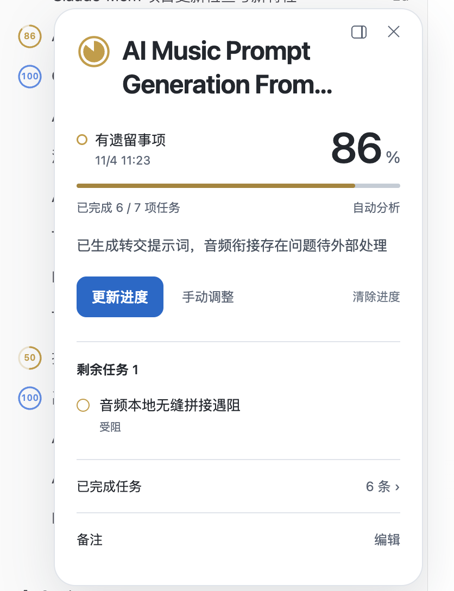
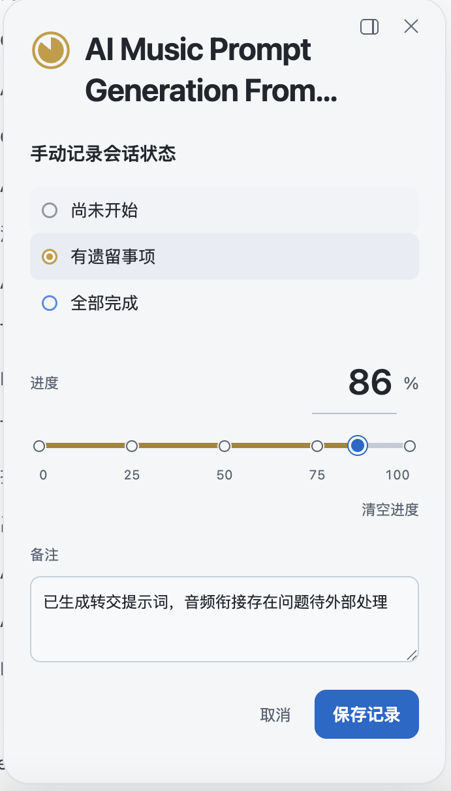
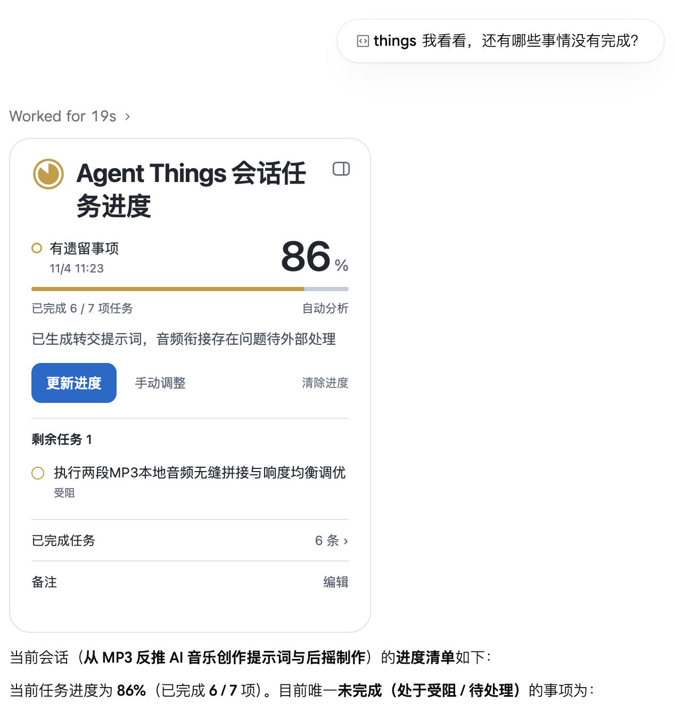
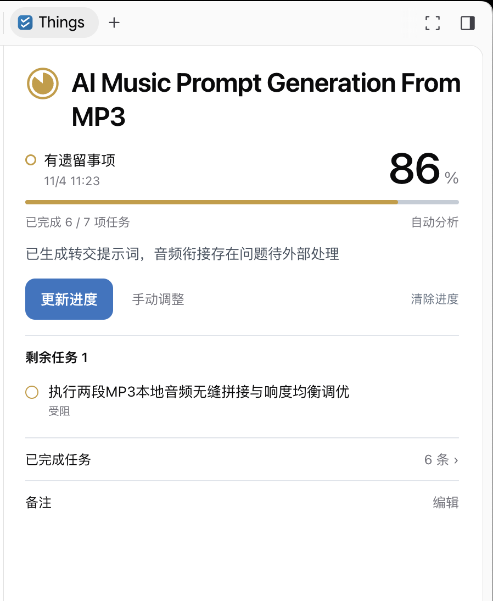

# Agent Things

English | [简体中文](docs/README.zh-CN.md)

When you juggle several sessions at once, or come back to one you haven't touched in a while, Agent Things shows you at a glance how far each session has got and what is still open, so you can decide whether to archive it or keep following up. You can also jump from any task back to the message it came from.

Agent Things is a session progress plugin for AI coding sessions on macOS. It supports local sessions in **ChatGPT**, **Antigravity**, **Claude Desktop**, and **DeepSeek Harness** (`dsh`). Inspired by [Things 3](https://culturedcode.com/things/): one progress ring sums up where a piece of work stands, and opening it gives you a clear to-do list.

> This is a beta release; see Known limitations below. This project is not affiliated with Cultured Code, OpenAI, Google or Anthropic.

<table>
  <tr>
    <td width="50%"></td>
    <td width="50%"></td>
  </tr>
  <tr>
    <td align="center">Progress rings in the session list and the status panel</td>
    <td align="center">Adjust status, progress and notes by hand</td>
  </tr>
  <tr>
    <td width="50%"></td>
    <td width="50%"></td>
  </tr>
  <tr>
    <td align="center">Type <code>/things</code> in a session to see its progress (Claude)</td>
    <td align="center">The Things side panel in Antigravity</td>
  </tr>
</table>

## Features

**See progress at a glance**

- Each item in the session list gets a progress ring; the number is the completion percentage. The color shows the session's state: gray for not started, gold for remaining items, blue for completed, and purple for completed and pushed to the remote (for example origin/main).
- Click the ring to open the status panel, with the session's state, completion rate, a one-line summary, remaining tasks and completed tasks.

**Tasks organized for you**

- Click **Update progress** and the plugin reads the conversation, asks the model you are already signed in to for a task list, separates completed from remaining items and flags blocked tasks.
  (By default it picks the most cost-effective model in each client: ChatGPT: Luna, Claude Code: Haiku, Antigravity: Gemini 3.8, DeepSeek Harness: DeepSeek-V4.1-Flash · Low, which can also be customized in **Plugins → agent-things-dsh**.)
- Later updates only process new messages; existing tasks and completion records stay as they are.
- Every task links back to the message it came from, so you can check it.

**Record things yourself**

- **Adjust** lets you set the state (Not started / Remaining items / Completed), drag the progress and write notes.
- **Clear** removes the session's progress, tasks, notes and history.

**Ask from inside the session**

- Type `/things` in any session and the model reads the checklist, shows a progress card in the conversation, and reads or updates progress (works together with the bundled skill).
- The plugin also registers MCP tools (read / update progress, update tasks, list all sessions, clear progress), so the assistant can record progress on its own while it works.

**English and Chinese**

- The interface, the `/things` card, the skills and the tasks the model writes all use one language: English or Simplified Chinese.
- The first install suggests your system language; you can switch it later from the management menu. After switching, the next **Update progress** rewrites existing tasks in the new language.

## Supported clients

| Client | Where it shows | First-time setup |
| --- | --- | --- |
| ChatGPT | Progress rings in the session list, status panel, `/things` | None. Open it from the Dock as usual; see "Why does ChatGPT close and reopen once?" below |
| Antigravity | Progress rings in the session list, Things side panel, `/things` | None |
| Claude Desktop (local Code sessions) | `/things` card in the conversation; session-list rings must be turned on | Run `/reload-plugins` after installing; for session-list rings, turn on **Developer → Enable Main Process Debugger** |
| DeepSeek Harness (`dsh`) | Progress rings in the session list, `things` right-side pane, `/things`, Plugin Manager model settings | Requires Node.js 24.9+; start with `dsh --profile web` |

## Installation

Requires macOS (Apple Silicon or Intel), Node.js 22 or later (Node.js 24.9+ when enabling DeepSeek Harness), and at least one of the clients above, installed and signed in.

```sh
npx agent-things
```

The wizard asks for your language and the clients to enable. It installs the plugin runtime, a background service, the MCP configuration and the `/things` skills into your user folder; you don't need to close any open client. When it finishes, reconnect the MCP server in your client.

To skip the questions and set up every installed client:

```sh
npx agent-things setup --yes
```

To force the latest version, run `npx agent-things@latest`.

## Data and privacy

- Progress, tasks and notes are stored only on your Mac:
  - ChatGPT: `~/Library/Application Support/CodexSessionStatus/manual-state.json`
  - Antigravity: `~/.gemini/antigravity/session-status/manual-state.json`
  - Claude: `~/Library/Application Support/AgentThings/claude/manual-state.json`
  - DeepSeek Harness: `~/Library/Application Support/AgentThings/deepseek/manual-state.json`
- The plugin has no telemetry and uploads nothing.
- **Update progress** calls a model through the Codex CLI built into ChatGPT, the Antigravity command line, Claude Code (Haiku), or DeepSeek Harness (`DeepSeek-V4.1-Flash · Low` by default, or the provider/model selected in **Plugins → agent-things-dsh**), and sends the user and assistant text of the session to that model. Raw tool output, reasoning and images are not sent.
- For desktop Electron apps, the plugin draws its interface through each client's local debugging interface and only accepts loopback addresses; for DeepSeek Harness, it mounts natively inside `dsh` as a Cordis plugin. See [SECURITY.md](SECURITY.md) for details.

## Updating and uninstalling

- The plugin checks the official npm registry for a new version once a day; both the panel (below the notes) and the management menu show when an update is available.
- Updates run as a separate background job, so you can close the terminal and the panel. They wait for any running analysis to finish and keep your ledger and client selection.
- To uninstall, run `npx agent-things` again and choose Uninstall from the menu. This stops the background service and removes the MCP entries and program files, keeping your ledger and backups.

## Commands

Every command runs as `npx agent-things <command>`. Day-to-day you only need the first two; the rest are for troubleshooting or manual management.

| Command | What it does |
| --- | --- |
| `npx agent-things` | Opens the interactive wizard: installs on first run, then opens the management menu (Health check, Update enabled apps, Switch language, Check for updates / upgrade, Sync components and skills, Uninstall) |
| `npx agent-things setup` | Same as above. Add `--yes` (or `--all`) to skip the questions and set up every installed client; add `--lang en` or `--lang zh` to choose the interface and analysis language (without it, the existing setting is kept, or the system language is used on first install) |
| `npx agent-things doctor` | Shows diagnostics for clients, the background service and interface mounting |
| `npx agent-things --help` | Shows command help |

These commands apply to ChatGPT only:

| Command | What it does |
| --- | --- |
| `npx agent-things status` | Prints, as JSON, the ledger location, the number of recorded sessions, and the state of the background service and interface mounting |
| `npx agent-things run` | Runs the progress service and mounts the interface in the foreground, for debugging; press Ctrl+C to exit. Add `--watch-startup` to also handle ChatGPT's startup handoff |
| `npx agent-things mcp` | Runs the MCP server over stdio; normally started by the client |
| `npx agent-things install-mcp` | Adds the MCP server to `~/.codex/config.toml` |
| `npx agent-things disable-mcp` | Removes the MCP server from `~/.codex/config.toml` |
| `npx agent-things install-autostart` | Installs the background service, which starts at login and mounts the interface |
| `npx agent-things disable-autostart` | Turns off the background service, keeping existing records |
| `npx agent-things update-renderer` | Replaces the installed interface resources with the ones from this version |

`run`, `status` and `mcp` accept `--port <port>` (default 39222); `run`, `status`, `mcp`, `install-autostart` and `update-renderer` accept `--data-dir <folder>` to use a different data folder.

## FAQ

**How do I switch between English and Chinese?**

Run `npx agent-things` and choose **Switch language** in the management menu. This reinstalls the skills for all enabled clients and the interface switches with it; reconnect the MCP server in your client so the assistant also sees the tool descriptions in the new language. Existing tasks are rewritten in the new language at the next **Update progress**; notes are left as they are.

**Why does ChatGPT close and reopen once?**

The release build of the ChatGPT desktop app doesn't let outside programs attach to its interface while it is running; the local debugging port can only be added at launch. Once the window is ready, the plugin asks ChatGPT to quit normally (the same as ⌘Q, so your work is saved) and reopens it with the debugging port. This usually takes 15 seconds or more, mostly spent in the client's own shutdown. Antigravity and Claude can be attached while running; without **Enable Main Process Debugger**, Claude only gets the in-conversation card.

**I don't see the progress rings in the session list. What should I do?**

Run `npx agent-things doctor` to see diagnostics for the clients, the background service and interface mounting. Right after ChatGPT opens, wait for it to reopen once; Claude's session-list rings need **Enable Main Process Debugger** turned on first.

**Does it modify the clients?**

No. The plugin doesn't change any client's app bundle, signature or security settings, and client updates are unaffected.

**Can I add to-do items by hand?**

Agent Things relies on the LLM to keep the task list up to date, which saves you from tedious bookkeeping. If there is something you want to write down, use the notes. Adding tasks through the conversation may come in a future release.

**Does progress update automatically?**

Not on a timer. Progress updates in three ways: clicking **Update progress** in the panel; typing `/things` in the session so the assistant reads or updates it; and the assistant recording progress through the MCP tools while it works. This way it never uses your model quota without you noticing.

**Does Update progress use my model quota?**

Yes. Analysis uses the account you are signed in to in that client, with the most cost-effective model available there by default. Later updates only process messages added since the last one, so they cost much less than the first analysis.

**What if the model's task list is wrong?**

Add a few messages explaining what actually happened, then click **Update progress** again; or use **Adjust** to change the state, progress and notes directly. If the whole list is far off, **Clear** it and analyze again.

**Can I undo Clear?**

No. Clearing immediately deletes the session's progress, all tasks, notes and history, with no backup.

**Why do some sessions have no progress ring?**

Sessions with no record don't show a ring until you hover over or select them; click it to start recording. Sessions being analyzed show a loading state.

**What does the purple ring mean?**

All tasks are complete and the conversation shows the changes were pushed to the remote repository. It only appears when the project has a Git remote configured. The plugin checks for a Git remote locally and never goes online to do so.

**Does analysis read my code?**

No. Analysis only uses the user and assistant text in the session; raw tool output, reasoning and images are never sent to the model. The plugin doesn't read your project files either.

**Can I turn off the automatic reopen when ChatGPT starts?**

There is no menu option yet. Set `allowClientRestart` to `false` in `~/Library/Application Support/CodexSessionStatus/autostart.json`, then run `npx agent-things` and reinstall to restart the background service. After that, ChatGPT only shows progress rings when it was launched with the debugging port; `/things` and the MCP tools are unaffected.

**The progress rings disappeared after a client update. What now?**

Run `npx agent-things doctor` first. If the client's interface changed significantly, you'll need to wait for a plugin release that supports the new version; meanwhile `/things` and the MCP tools usually keep working and your ledger is unaffected.

**Why doesn't `/things` respond?**

After installing or updating, reconnect the MCP server in your client; Claude also needs `/reload-plugins` once. If it still doesn't work, run `npx agent-things doctor` to check the background service.

**Can progress sync between Macs?**

Not yet. All data is stored in your user folder on this Mac; there is no cloud service.

**Does it support Windows or Linux?**

Not yet. The plugin relies on native macOS interfaces to manage client startup and interface mounting, so it currently supports macOS only (Apple Silicon and Intel).

**Is my data kept after uninstalling?**

Uninstalling keeps your ledger and backups, and progress comes back when you reinstall. To delete everything, remove the data folders listed under "Data and privacy" after uninstalling.

## Known limitations

- The plugin depends on each client's internal interface structure. After a major client update, the plugin may need an update too before the interface shows again.
- The model's task list can miss items or merge them poorly; use **Adjust** to correct it.

## Development

See [CONTRIBUTING.md](CONTRIBUTING.md). Common commands:

```sh
npm ci --ignore-scripts
npm run verify
```

## License

[MIT](LICENSE) © 2026 snuffpic

## Roadmap

- OKtaMind support
