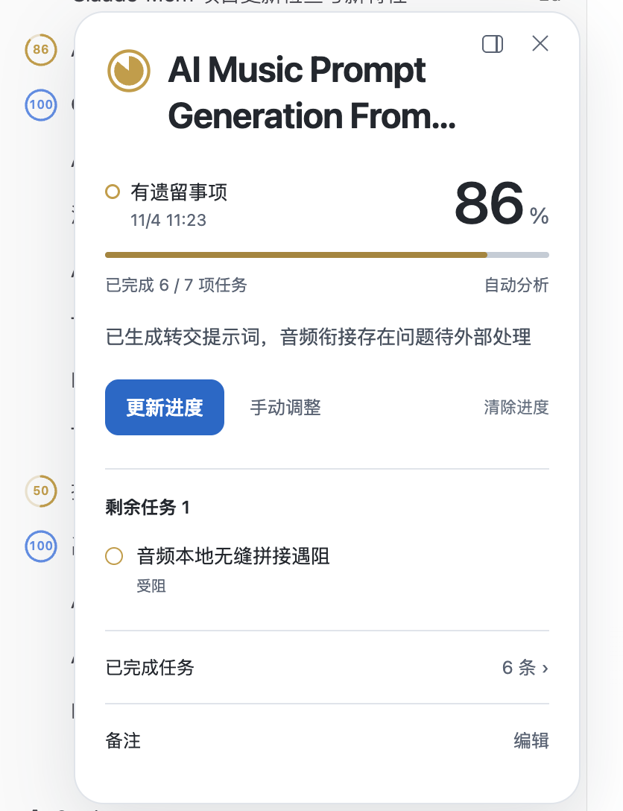
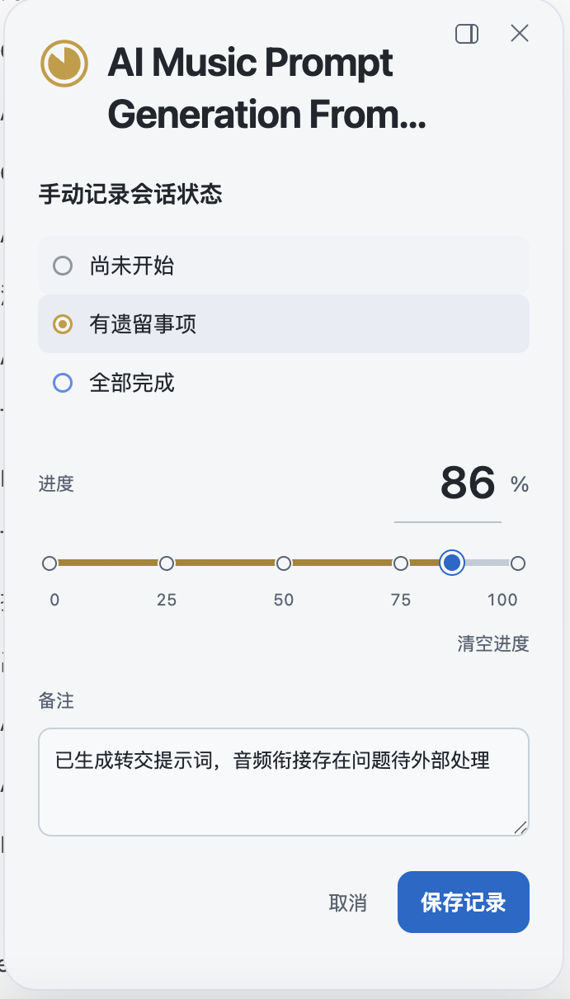
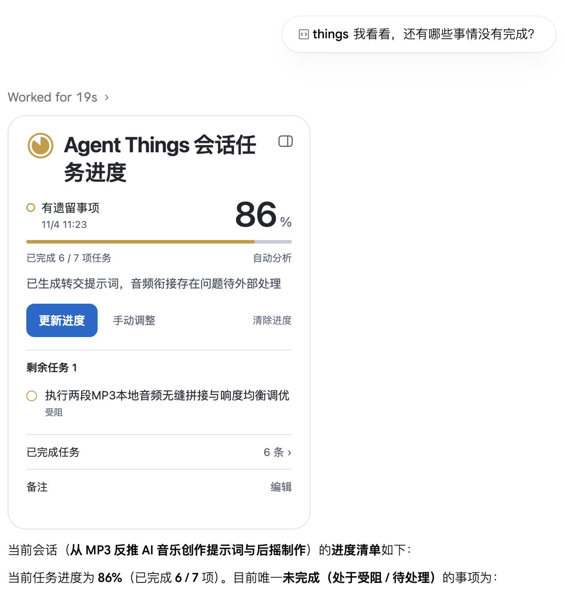
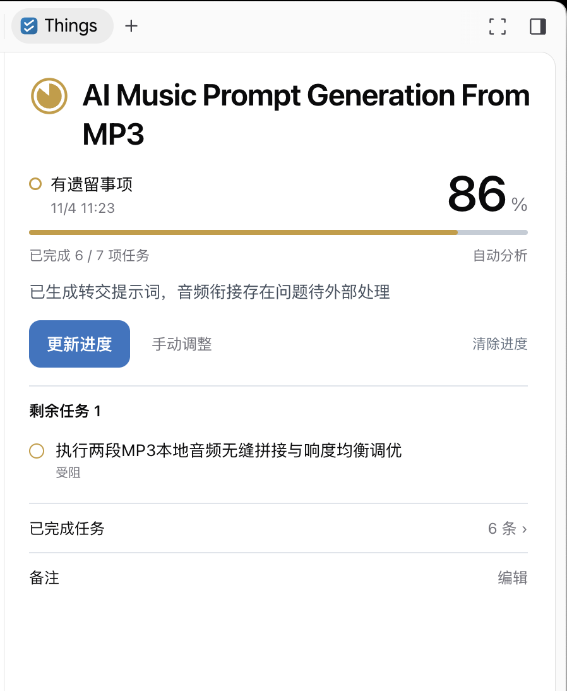

# Agent Things

[English](../README.md) | 简体中文

当你在同时处理多个会话时或太久没使用某个会话，Agent Things 可以帮助你快速了解会话的进度和待办事项，从而判断是否需要归档和追踪，你还可以点击查看来源快速跳转、回顾历史信息。

Agent Things 是 macOS 上的 AI 编程会话进度插件，支持 **ChatGPT**、**Antigravity**、**Claude Desktop** 本地会话以及 **DeepSeek Harness**（`dsh`）。灵感来自 [Things 3](https://culturedcode.com/things/)：用一个进度圆环概括一件事做到了哪里，打开后就是一份清楚的待办清单。

> 当前为 Beta 版本，已知限制见文末。本项目与 Cultured Code、OpenAI、Google、Anthropic 均无关联。

<table>
  <tr>
    <td width="50%"></td>
    <td width="50%"></td>
  </tr>
  <tr>
    <td align="center">会话列表的进度圆环与状态面板</td>
    <td align="center">手动调整状态、进度与备注</td>
  </tr>
  <tr>
    <td width="50%"></td>
    <td width="50%"></td>
  </tr>
  <tr>
    <td align="center">在会话中输入 <code>/things</code> 查看进度（Claude）</td>
    <td align="center">Antigravity 侧边的 Things 面板</td>
  </tr>
</table>

## 功能

**快速查看进度**

- 会话列表每一项左侧显示进度圆环，数字是完成百分比；颜色表示会话状态：灰色为尚未开始，金色为有遗留事项，蓝色为全部完成，紫色为全部完成并已推送到远端（如 origin/main）。
- 点击圆环打开状态面板，查看会话状态、完成比例、一句话概括、剩余任务和已完成任务。

**自动整理任务**

- 点击「更新进度」，插件读取会话中的对话，调用你已登录的模型整理出任务清单，区分已完成和剩余的事项，并标出受阻的任务。
（默认选用性价比最高的模型：ChatGPT：Luna，Claude Code：Haiku，Antigravity：Gemini 3.8，DeepSeek Harness：DeepSeek-V4.1-Flash · Low，可在「插件 → agent-things-dsh」页面自定义任务解析模型与思考程度）
- 再次更新时只增量处理新的对话，已有任务和完成记录保持不变。
- 每项任务都能跳回会话中对应的原文，方便核对。

**手动记录**

- 「手动调整」可以直接设置状态（尚未开始 / 有遗留事项 / 全部完成）、拖动进度，并填写备注。
- 「清除进度」会清空该会话的进度、任务、备注与进展记录。

**在会话里直接问**

- 在任意会话中输入 `/things`，模型会读取这份清单，在消息流中显示进度卡片，并读取或更新进度（搭配Skill使用）。
- 插件同时注册 MCP 工具（读取 / 更新进度、更新任务、列出所有会话、清除进度），助手在工作过程中也可以自己记录进度。

**中英双语**

- 界面、`/things` 卡片、技能说明和模型整理出的任务都使用同一种语言：简体中文或 English。
- 首次安装时按系统语言推荐，之后可在管理菜单中切换；切换后再次「更新进度」，已有任务会改写为新的语言。

## 支持的客户端

| 客户端                        | 显示位置                             | 首次使用需要做的事                                                               |
| -------------------------- | -------------------------------- | ----------------------------------------------------------------------- |
| ChatGPT                    | 会话列表进度圆环、状态面板、`/things`          | 无。从 Dock 正常打开即可，见下方“为什么 ChatGPT 会重新打开一次”                                  |
| Antigravity                | 会话列表进度圆环、侧边 Things 面板、`/things`  | 无                                                                       |
| Claude Desktop（本地 Code 会话） | 消息流中的 `/things` 卡片；会话列表进度圆环需手动开启 | 安装后执行 `/reload-plugins`；如需会话列表圆环，开启「开发者 → Enable Main Process Debugger」 |
| DeepSeek Harness（`dsh`）    | 会话列表进度圆环、右侧 `things` 面板、`/things`、插件详情页模型配置 | 需 Node.js 24.9 及以上；运行 `dsh --profile web` 启动                            |

## 安装

需要 macOS（Apple Silicon 或 Intel）、Node.js 22 及以上（若启用 DeepSeek Harness 需 Node.js 24.9+），以及已安装并登录的上述客户端之一。

```sh
npx agent-things
```

按向导选择语言和要启用的客户端。安装会在用户目录中写入插件运行时、后台服务、MCP 配置和 `/things` 技能，过程中不需要关闭已打开的客户端。安装完成后，在客户端中重新连接 MCP 服务。

如需跳过选择、自动配置已安装的全部客户端：

```sh
npx agent-things setup --yes
```

需要强制使用最新版本时，可运行 `npx agent-things@latest`。

## 数据与隐私

- 进度、任务和备注只保存在本机：
  - ChatGPT：`~/Library/Application Support/CodexSessionStatus/manual-state.json`
  - Antigravity：`~/.gemini/antigravity/session-status/manual-state.json`
  - Claude：`~/Library/Application Support/AgentThings/claude/manual-state.json`
  - DeepSeek Harness：`~/Library/Application Support/AgentThings/deepseek/manual-state.json`
- 插件没有任何遥测或上传服务。
- 「更新进度」会通过本机已登录的 ChatGPT 内置 Codex CLI、Antigravity 命令行、Claude Code（Haiku）或 DeepSeek Harness（默认 `DeepSeek-V4.1-Flash · Low`，可在「插件 → agent-things-dsh」调整）调用模型，并把会话中的用户与助手文本发送给该模型；工具原始输出、思考过程和图片不会发送。
- 桌面端 Electron 客户端通过本机调试接口显示界面（只接受本机回环地址）；DeepSeek Harness 则以 `dsh` 原生 Cordis 插件方式挂载运行。详细说明见 [SECURITY.md](../SECURITY.md)。

## 升级与卸载

- 插件每天从 npm 官方仓库检查一次新版本，面板备注下方和管理菜单都会提示升级。
- 升级在独立的后台任务中执行，可以关闭终端和面板；会等待正在进行的分析结束，并保留账本和客户端选择。
- 再次运行 `npx agent-things`，在菜单中选择卸载：停止后台服务，移除 MCP 入口和程序文件，保留账本与备份。

## 命令

所有命令都通过 `npx agent-things <命令>` 运行。日常使用只需要前两条，其余用于排查或手动管理。

| 命令 | 说明 |
| --- | --- |
| `npx agent-things` | 打开交互式向导：首次运行时安装，之后进入管理菜单（查看运行状态、修改启用的客户端、切换界面与分析语言、检查更新 / 升级、同步组件与技能、卸载） |
| `npx agent-things setup` | 同上；加 `--yes`（或 `--all`）跳过选择并配置已安装的全部客户端，加 `--lang zh` 或 `--lang en` 指定界面与分析语言（不指定时沿用已有设置，首次安装按系统语言） |
| `npx agent-things doctor` | 查看客户端、后台服务和界面挂载的诊断信息 |
| `npx agent-things --help` | 显示命令帮助 |

以下命令只作用于 ChatGPT：

| 命令 | 说明 |
| --- | --- |
| `npx agent-things status` | 以 JSON 输出账本位置、已记录的会话数、后台服务与界面挂载状态 |
| `npx agent-things run` | 在前台运行进度服务并挂载界面，用于调试；按 Ctrl+C 退出。加 `--watch-startup` 同时接管 ChatGPT 的启动交接 |
| `npx agent-things mcp` | 以 stdio 方式运行 MCP 服务，一般由客户端自动调用 |
| `npx agent-things install-mcp` | 把 MCP 服务写入 `~/.codex/config.toml` |
| `npx agent-things disable-mcp` | 从 `~/.codex/config.toml` 中移除 MCP 服务 |
| `npx agent-things install-autostart` | 安装后台服务，登录后自动运行并挂载界面 |
| `npx agent-things disable-autostart` | 关闭后台服务，保留已有记录 |
| `npx agent-things update-renderer` | 用当前版本的界面资源替换已安装的资源 |

`run`、`status`、`mcp` 支持 `--port <端口>`（默认 39222）；`run`、`status`、`mcp`、`install-autostart`、`update-renderer` 支持 `--data-dir <目录>` 指定数据目录。

## 常见问题

**怎么切换中文和英文？**

运行 `npx agent-things`，在管理菜单中选择「切换界面与分析语言」。切换会重新安装已启用客户端的技能，界面随之切换；之后在客户端中重新连接 MCP 服务，助手看到的工具说明也会换成新语言。已有任务在下一次「更新进度」时改写为新语言，备注保持原样。

**为什么 ChatGPT 打开后窗口会关掉再重新打开一次？**

ChatGPT 桌面应用的正式版不允许外部程序在运行中接入界面，只能在启动时附加本机调试端口。插件会在窗口就绪后请求它正常退出（与 ⌘Q 相同，会完成保存），再带上调试端口重新打开。整个过程通常需要 15 秒或更久，主要取决于客户端自身的退出收尾。Antigravity 和 Claude 支持运行中接入，Claude 如未打开「Enable Main Process Debugger」，将仅可使用会话内卡片。

**会话列表里看不到进度圆环怎么办？**

运行 `npx agent-things doctor`，查看客户端、后台服务和界面挂载的诊断信息。ChatGPT 刚打开时需要等它重新打开一次；Claude 的会话列表圆环需要先开启「Enable Main Process Debugger」。

**会修改客户端吗？**

不会。插件不修改任何客户端的应用包、签名或安全设置，客户端更新也不会受影响。

**是否支持手动添加待办事项？**

Agent Things 依赖 LLM 更新具体待办事项，免去了繁琐的记录过程。如有需要记录的内容，可使用备注记录，但不排除在未来添加通过对话添加待办事项的功能。

**进度会自动更新吗？**

不会定时自动更新。进度在以下三种情况下更新：点击面板中的「更新进度」；在会话中输入 `/things` 让助手读取或更新；助手在工作过程中通过 MCP 工具自行记录。这样不会在你没注意的时候消耗模型额度。

**「更新进度」会消耗我的模型额度吗？**

会。分析使用你在对应客户端中已登录的账号，默认选用该客户端里性价比最高的模型。再次更新时只处理上次之后新增的对话，消耗会明显少于首次分析。

**模型整理的任务不准确怎么办？**

可以先补充几句对话说明实际情况，再点「更新进度」重新整理；也可以用「手动调整」直接修改状态、进度和备注。如果整份清单偏差很大，可以「清除进度」后重新分析。

**「清除进度」可以撤销吗？**

不可以。清除会立即删除该会话的进度、全部任务、备注和进展记录，且不保留备份。

**为什么有的会话没有显示进度圆环？**

没有任何记录的会话默认不显示圆环，鼠标移到该会话上或选中它时才会出现，点击即可开始记录。分析进行中的会话会显示加载状态。

**紫色圆环代表什么？**

表示任务全部完成，且对话显示改动已推送到远端仓库。只有项目配置了 Git 远端时才会出现这个状态。插件只在本机读取项目是否配置了 Git 远端，不访问网络。

**分析时会读取我的代码吗？**

不会。分析只使用会话中的用户与助手文本；工具原始输出、思考过程和图片都不会发送给模型。插件也不会读取项目文件内容。

**可以关闭 ChatGPT 启动时的自动重开吗？**

目前没有菜单开关。可以把 `~/Library/Application Support/CodexSessionStatus/autostart.json` 中的 `allowClientRestart` 改为 `false`，再运行 `npx agent-things` 重新安装以重启后台服务。关闭后，ChatGPT 只有在带调试端口启动时才会显示进度圆环，`/things` 和 MCP 工具不受影响。

**客户端更新后进度圆环不见了怎么办？**

先运行 `npx agent-things doctor` 查看诊断。如果客户端界面结构有较大变化，需要等待插件发布适配新版本；在此期间，`/things` 和 MCP 工具通常仍可使用，账本数据不受影响。

**为什么 `/things` 没有反应？**

安装或升级后，需要在客户端中重新连接 MCP 服务；Claude 需要执行一次 `/reload-plugins`。仍无效时，运行 `npx agent-things doctor` 检查后台服务状态。

**可以在多台电脑之间同步进度吗？**

暂不支持。所有数据都保存在本机用户目录，没有云端服务。

**支持 Windows 或 Linux 吗？**

暂不支持。插件依赖 macOS 原生接口来管理客户端的启动与界面挂载，目前仅支持 macOS（Apple Silicon 与 Intel）。

**卸载后数据还在吗？**

卸载会保留账本与备份，重新安装后进度会自动恢复。如需彻底删除，可在卸载后手动删除“数据与隐私”中列出的数据目录。

## 已知限制

- 插件依赖客户端的内部界面结构。客户端大版本更新后，界面显示可能需要插件随之更新。
- 模型整理的任务清单可能有遗漏或合并不当，可以用「手动调整」修正。

## 开发

参见 [CONTRIBUTING.md](../CONTRIBUTING.md)。常用命令：

```sh
npm ci --ignore-scripts
npm run verify
```

## 许可

[MIT](../LICENSE) © 2026 snuffpic

## 更新计划

- OKtaMind 支持
